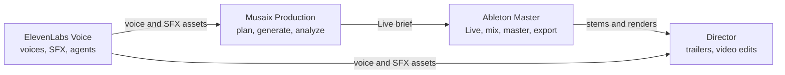

# Musaix Bot Separation Architecture

Status: canonical · Owner: Sterl Atkinson (S73RL) · Last updated: 2026-11-17

Musaix Pro / Alic3X work is split across separate Grok Bots, and each bot owns exactly one lane. **Never merge the bots.** When a task crosses a lane, the bot that owns the current step writes a brief and hands it to the bot that owns the next one.

## Lanes

| Bot | Owns | Never does |
|---|---|---|
| **Musaix Production** | Music generation and session planning: ElevenLabs Music (`music_v2_5`) and composition plans, Cold Case freestyles, track analysis, session-bootstrap briefs, rap vocal template design, and cognition-engine metadata (`MUSAIX_CAPTURE`). | Direct Live control (no OSC, no Alic3X bridge commands), mastering, mix prep, arrangement execution, exports, trailers or video edits, and making ElevenLabs voices, SFX or agents. |
| **Ableton Master** | Direct Live 12.4 Suite control on s73rl, OSC, the Alic3X bridge, transport and set changes, mix prep, arrangement execution, mastering, and exports. | Music generation, session planning, and video. |
| **Director** | Cutting trailers and video edits. | Music generation and Live operations. |
| **ElevenLabs Voice** | Making ElevenLabs voices, sound effects, and ElevenAgents. | ElevenLabs Music generation (that is Musaix Production) and Live operations. |

## Handoffs

- **Musaix Production to Ableton Master:** any transport, set change, mix prep, arrangement, mastering, or export goes out as a written brief. Musaix Production never drives Live itself.
- **To Director:** finished audio and video assets go over for trailers and edits.
- **From ElevenLabs Voice:** voices, SFX and agents are requested from it, never made in another lane.

## Rules

1. **Sovereign session memory.** Each bot keeps its own session memory. Bots share state through briefs and files, never by writing into each other's memory.
2. **Non-destructive by default.** No deletes or overwrites without Sterl's explicit approval. Work on copies, keep the originals, and spend credits only with his approval.
3. **Coordinate, don't absorb.** Musaix Production coordinates with the cognition engine (`MUSAIX_CAPTURE` metadata), the Liquid Noir Cassette Cockpit, and the Iron Circle GPU cluster without taking over their jobs.
4. **Never merge the bots.** A new capability goes to the bot whose lane owns it, or to a new bot, and never widens an existing lane.

## Connected systems

- **Cognition engine:** the 6-layer Musaix model (Sonic, Structural, Emotional, Lyrical/Narrative, Genre/Identity, Predictive/Optimization), fed by `MUSAIX_CAPTURE` metadata.
- **Liquid Noir Cassette Cockpit:** the session UI and cockpit layer.
- **Iron Circle:** Sterl's distributed GPU compute cluster (RTX 4070 Super).
